  <picture>
    <source media="(prefers-reduced-motion: reduce)" srcset="./assets/readme/static/profile-hero.svg">
    
  </picture>

## Hey, I'm Zheng 👋 你好，我是钲

AI engineer, Miuix fan, and a little too particular about how interfaces feel.

I build Android apps, Windows tools, and small web services — with a soft spot for smooth motion and thoughtful details.

写代码，也打磨 UI、动效和交互。喜欢用 AI Agent 和自动化处理重复工作，把时间留给有趣的细节。

 

## Selected work · 我的作品

  <a href="https://github.com/bileizhen/CurrentMusicX"><picture><source media="(prefers-reduced-motion: reduce)" srcset="./assets/readme/static/project-currentmusicx.svg"></picture></a>
  <a href="https://github.com/bileizhen/XBlocker"><picture><source media="(prefers-reduced-motion: reduce)" srcset="./assets/readme/static/project-xblocker.svg"></picture></a>
  <a href="https://github.com/bileizhen/LeiFetch"><picture><source media="(prefers-reduced-motion: reduce)" srcset="./assets/readme/static/project-leifetch.svg"></picture></a>
  <a href="https://github.com/bileizhen/ReToolbox"><picture><source media="(prefers-reduced-motion: reduce)" srcset="./assets/readme/static/project-retoolbox.svg"></picture></a>

## Toolbox · 常用工具

  

## After hours · 代码之外

<picture>
  <source media="(prefers-color-scheme: dark)" srcset="https://raw.githubusercontent.com/bileizhen/bileizhen/output/github-snake-Dark.svg">
  <source media="(prefers-color-scheme: light)" srcset="https://raw.githubusercontent.com/bileizhen/bileizhen/output/github-snake-Light.svg">
  
</picture>

## Visitors · 来过的小伙伴

